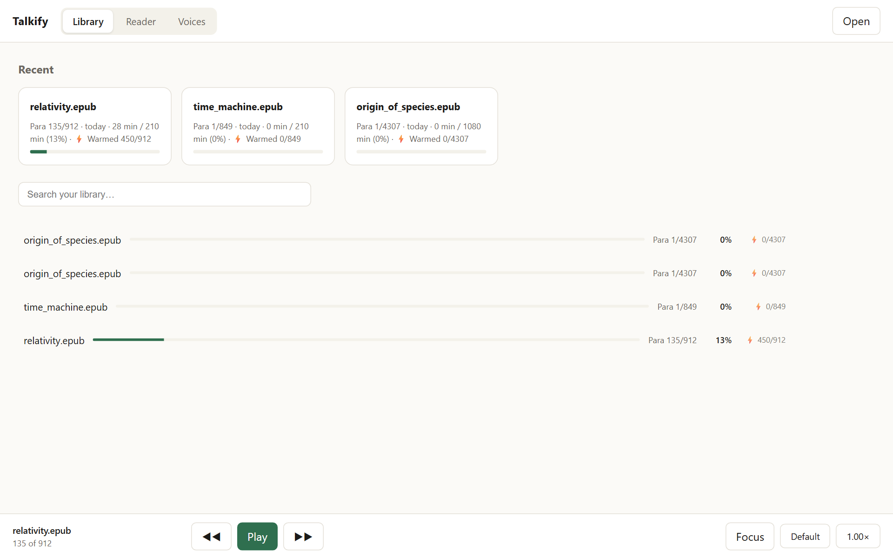
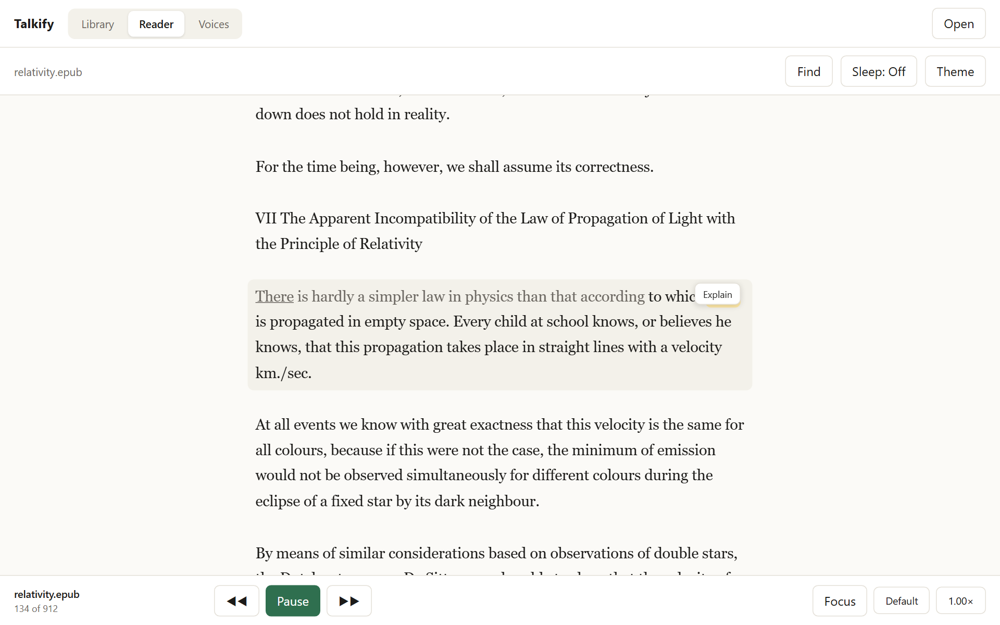
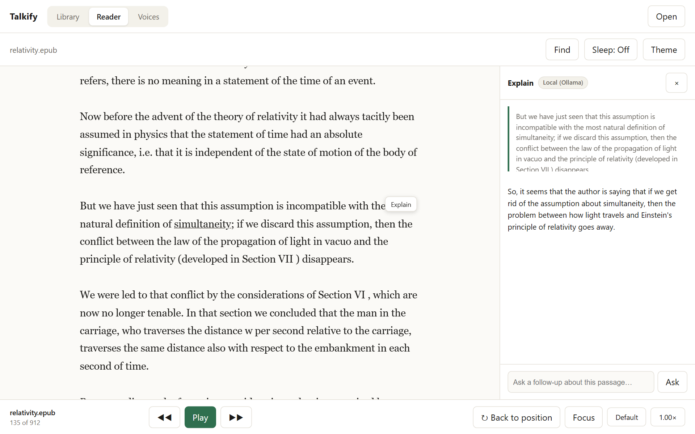
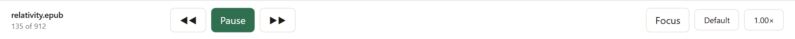
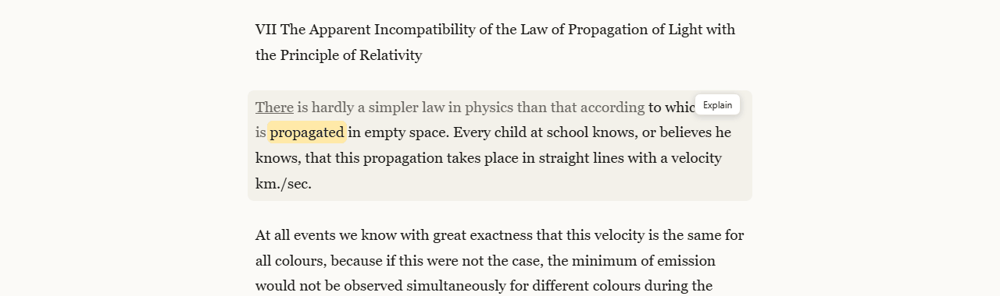
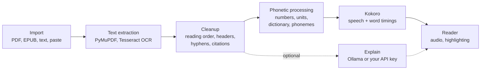

# Talkify

An offline desktop reader that reads PDFs, EPUBs and pasted text aloud, and highlights each word as it is spoken.

Talkify is an independent personal project. It is not affiliated with talkify.net or any other product that uses the name.

## Why I built it

I listen to Speechify on long commutes. Two things kept bothering me: the delay before audio starts, and the fact that it needs Wi-Fi or a cell connection to work at all. A tunnel or a dead zone means the book stops.

Talkify runs entirely on my own machine. The voice model and the text processing run locally, and so can the optional explanations from a local language model, so it works the same with no connection.

## Screenshots

**Library.** Recent documents with progress, and the full list below.



**Reader.** The current paragraph is shaded and the word being spoken is highlighted.



**Explain panel.** Select a passage and ask a local model about it.



**Control bar.** Play, previous and next paragraph, jump back to the reading position, focus mode, voice, speed.





## What it does

- **Import.** PDF, EPUB and plain text files, or paste text straight in (for example, an article copied from a web page). You can choose a page range of a PDF.
- **OCR for scanned pages.** Scanned PDFs go through Tesseract, page by page in the background, so reading can start before the whole book is done.
- **Text cleanup.** Fixes the things that make textbook audio hard to listen to: two-column reading order, running heads and page numbers cutting into sentences, words hyphenated across lines, figure captions interrupting a paragraph, and citations like "(Smith 2019)" or "[12]", which are skipped. URLs are read as one word.
- **Phonetic processing.** Text is converted to phonemes before synthesis, abbreviations, numbers and units are expanded into words, and a pronunciation dictionary lets you fix names the voice gets wrong.
- **Speech.** [Kokoro](https://huggingface.co/hexgrad/Kokoro-82M), an open-source text-to-speech model, with a voice picker for its American and British voices.
- **Reader view.** Word-by-word highlighting, paragraph highlighting, click any word to start reading from there. The page only scrolls when the current word gets close to the edge of the screen.
- **Playback.** Speed control (0.75x to 2x), sleep timer (15, 30 or 45 minutes, or end of document), and resume where you left off in every document.
- **Reading comfort.** Light, dark and paper themes, a night filter, and a focus mode that dims everything but the current paragraph.
- **Navigation.** Chapter list (detected from the running heads printed at the top of textbook pages), search inside a document, and a filter for the library list.
- **Split view.** Shows the original PDF page next to the text, and pops up a figure when the narration says "as shown in Figure 3.2".
- **Audio export.** Exports a document, or one MP3 per chapter, along with the word timings.
- **Phone sync.** Point the export folder at a folder your phone syncs (Google Drive, OneDrive, Dropbox) and the pre-generated chapter MP3s are on your phone for offline listening, no app needed.
- **Explain.** Select a passage and get a short explanation from a local model through [Ollama](https://ollama.com), or from Gemini, Claude or OpenAI if you add your own API key. The panel says when text is leaving your machine. With neither set up, the feature is hidden.

## How it works



1. **Extraction.** PyMuPDF pulls text from PDFs along with where each line sits on the page, which is what makes column and header detection possible. Pages with no text layer are rendered and sent to Tesseract.
2. **Cleanup.** The text is rebuilt into paragraphs and split into blocks of 320 characters or fewer. Short blocks mean the first audio arrives quickly instead of waiting on a whole page.
3. **Phonetic processing.** Each block gets a spoken version (numbers and units written out, citations removed, dictionary entries swapped in) that keeps a link back to the words on screen. That link is what keeps the highlight on the right word even when the spoken text is different from the displayed text.
4. **Speech.** Kokoro runs in its own Python process and returns audio plus the time each word starts and ends. Kokoro's duration predictor provides the timings directly. If they look wrong, faster-whisper listens to the audio and the words are aligned back onto the text.
5. **Reader.** The browser plays the blocks back to back with no gaps and moves the highlight using the timings. Upcoming blocks are generated ahead of time while you listen.

The server is plain Python standard library (`http.server`) and the reader is plain HTML, CSS and JavaScript, with no web framework.

## Setup

Tested on Windows 11 with Python 3.12. The setup script is PowerShell, so other platforms will need the equivalent commands by hand.

**You need:**

- Windows 10 or 11
- [Python 3.12](https://www.python.org/downloads/) (Kokoro's dependencies do not have wheels for newer versions yet)
- About 2.5 GB of free disk space: 1.3 GB for the voice engine (mostly PyTorch), 460 MB for the Kokoro and Whisper models, and the reader itself
- 8 GB of RAM. The voice model itself uses about 1 to 2 GB.
- Optional: [Tesseract OCR](https://github.com/UB-Mannheim/tesseract/wiki) for scanned PDFs
- Optional: [Ollama](https://ollama.com) for the Explain panel. The default model, `llama3.2`, is a 2 GB download and wants about 8 GB of RAM in total.

**Clone into a short path,** such as `C:\talkify-reader` or your Downloads folder. One of the voice engine's packages has very deep file paths, and Windows refuses paths over 260 characters unless [long path support](https://learn.microsoft.com/en-us/windows/win32/fileio/maximum-file-path-limitation#enable-long-paths-in-windows-10-version-1607-and-later) is turned on. In a deeply nested folder, step 3 fails with `OSError: [Errno 2] No such file or directory` and a hint about long paths.

**1. Get the code and install the reader:**

```powershell
git clone https://github.com/ronankwood-create/talkify-reader.git
cd talkify-reader
py -3.12 -m venv .venv
.venv\Scripts\python -m pip install -r requirements.txt
```

**2. Check the reader works** (no voice, plays silence, but highlighting and everything else works):

```powershell
.venv\Scripts\python talkify.py --engine stub
```

It opens `http://127.0.0.1:8765` in your browser. Paste some text or open a file.

**3. Install the voice engine** (one time, a few GB of downloads):

```powershell
powershell -ExecutionPolicy Bypass -File setup_kokoro.ps1
```

The script only creates a second virtual environment, `kokoro_venv`, and installs the voice packages into it. If you'd rather not bypass the execution policy, run the same thing by hand:

```powershell
py -3.12 -m venv kokoro_venv
kokoro_venv\Scripts\python -m pip install -r requirements-kokoro.txt
```

The versions in `requirements-kokoro.txt` are pinned on purpose. Installing the latest of everything currently breaks the voice engine at startup, because a newer PyAV release dropped an argument faster-whisper still uses.

**4. Run it:**

```powershell
.venv\Scripts\python talkify.py
```

The first run downloads the Kokoro model and voices (about 350 MB) from Hugging Face. After that, Talkify works fully offline.

### Offline with no language model and no API key

This is the default. With no Ollama running and no API key set, Talkify is a plain offline reader: import, cleanup, speech, highlighting, export and everything else work, and the Explain button is simply not shown.

### Optional extras

- **Explain with a local model:** install Ollama, run `ollama pull llama3.2`, and start Talkify. It finds Ollama on its own.
- **Explain with your own API key:** see [`.env.example`](.env.example). Set `GEMINI_API_KEY`, `ANTHROPIC_API_KEY` or `OPENAI_API_KEY` in your shell, or put it in `config.json`.
- **Pronunciation dictionary:** create `config.json` next to `talkify.py`:
  ```json
  {"pronunciations": {"Euler": "Oiler", "Callister": "Cal-ister"}}
  ```
  Capitalized keys match exactly. Lowercase keys match any capitalization.
- **Faster voice engine (ONNX):** download `kokoro-v1.0.onnx` and `voices-v1.0.bin` from the [kokoro-onnx releases](https://github.com/thewh1teagle/kokoro-onnx/releases/tag/model-files-v1.0) into a `kokoro_assets` folder, then set `$env:TALKIFY_KOKORO_BACKEND = "onnx"`. The files are checked against the hashes in `kokoro_onnx_assets.json` before use.
- **Online voices:** `--engine edge` uses Microsoft's neural voices through `edge-tts`. This one needs an internet connection.

### Tests

```powershell
.venv\Scripts\python smoke.py
```

Starts a throwaway server and checks the things that fail quietly: word timings that go backwards, audio length, alignment when the speech recognizer mishears a word, the worker protocol, and job priority.

## Status and known limitations

- Desktop only, and currently a web-based prototype: a local Python server with the reader in your browser.
- The highlight-to-explain flow is clunky, and the local model's explanations are not detailed enough yet.
- Table handling is close to done but still reads some tables in the wrong order.
- Practice problems (cards that point at worked examples in a textbook) are experimental.
- Library search matches document titles, not the text inside them.

## Roadmap

- A desktop executable, so there is no Python setup
- A better Explain feature
- Practice problems
- Mobile, someday

## License

Talkify's own code is under the [MIT License](LICENSE).

Some libraries it installs have stronger licenses. PyMuPDF and EbookLib are AGPL-3.0, and the eSpeak NG phonemizer used by Kokoro is GPL-3.0. None of them are included in this repository; they are installed by `pip` during setup. If you distribute Talkify bundled together with them, those licenses apply to the bundle.

## Credits

Talkify is built on these projects:

| Project | Used for | License |
|---|---|---|
| [Kokoro-82M](https://huggingface.co/hexgrad/Kokoro-82M) by hexgrad | voice model and voices | Apache-2.0 |
| [kokoro](https://github.com/hexgrad/kokoro), [misaki](https://github.com/hexgrad/misaki) | Kokoro runtime, text to phonemes | Apache-2.0 |
| [kokoro-onnx](https://github.com/thewh1teagle/kokoro-onnx) | optional ONNX runtime for Kokoro | MIT |
| [eSpeak NG](https://github.com/espeak-ng/espeak-ng) via phonemizer and espeakng-loader | phoneme fallback for unknown words | GPL-3.0 |
| [spaCy](https://spacy.io) | English tagging for phonemes | MIT |
| [PyTorch](https://pytorch.org) | runs the voice model | BSD-3-Clause |
| [ONNX Runtime](https://onnxruntime.ai) | optional voice model runtime | MIT |
| [faster-whisper](https://github.com/SYSTRAN/faster-whisper) and the [Whisper base.en](https://huggingface.co/Systran/faster-whisper-base.en) model | backup word timings | MIT |
| [PyMuPDF](https://pymupdf.readthedocs.io) | PDF text, layout and page images | AGPL-3.0 |
| [Tesseract](https://github.com/tesseract-ocr/tesseract), [pytesseract](https://github.com/madmaze/pytesseract) | OCR for scanned pages | Apache-2.0 |
| [EbookLib](https://github.com/aerkalov/ebooklib) | EPUB reading | AGPL-3.0 |
| [Beautiful Soup](https://www.crummy.com/software/BeautifulSoup/) | EPUB HTML | MIT |
| [Pillow](https://python-pillow.org) | images for OCR | MIT-CMU |
| [lameenc](https://github.com/chrisstaite/lameenc) (LAME) | MP3 export | LGPL-3.0 |
| [soundfile](https://github.com/bastibe/python-soundfile) | audio files | BSD-3-Clause |
| [edge-tts](https://github.com/rany2/edge-tts) | optional online voices | LGPL-3.0 |
| [Ollama](https://github.com/ollama/ollama) | optional local model for Explain | MIT |
| [Llama 3.2](https://www.llama.com/llama3_2/license/) (if you pull it) | default local model | Llama 3.2 Community License |

The books in the screenshots are public domain in the US and come from Project Gutenberg: [*Relativity: The Special and General Theory*](https://www.gutenberg.org/ebooks/5001) by Albert Einstein (translated by Robert W. Lawson), [*The Time Machine*](https://www.gutenberg.org/ebooks/35) by H. G. Wells, and [*On the Origin of Species*](https://www.gutenberg.org/ebooks/1228) by Charles Darwin.
